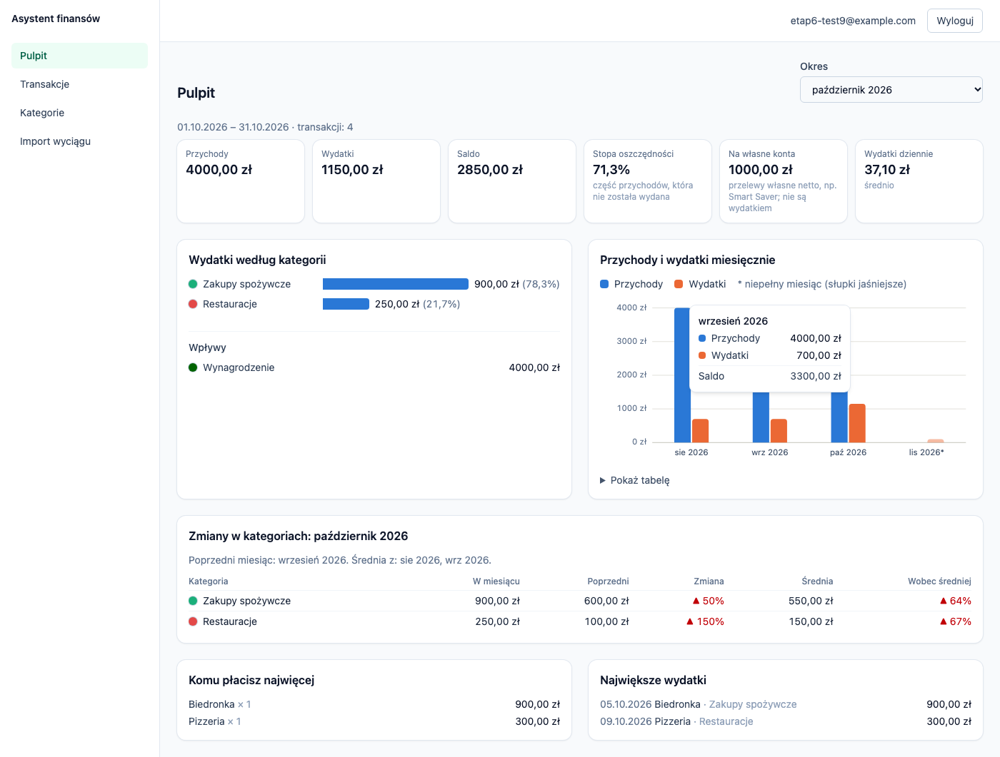

# Tydzień 6: analityka i pulpit

Plan przewiduje ten etap na 30 listopada – 6 grudnia 2026; wykonano go 11 listopada.

**Cel:** pulpit pokazuje rzeczywisty obraz wydatków i przychodów, a liczby zgadzają się z testami i z wyciągami.
Te same liczby zbiorcze trafią w etapie 7 do modułu porad AI (nigdy pojedyncze transakcje).

---

## 1. Decyzje

| Temat | Decyzja | Uzasadnienie |
|---|---|---|
| Obliczenia | czyste funkcje na `DataFrame` (Pandas) w `analytics_service.py`; jedno zapytanie do bazy | łatwe testy na ręcznie policzonych przykładach |
| Kwoty | grosze jako liczby całkowite (`int64`), w API tekst z dwoma miejscami po przecinku | sumy dokładne, bez błędów liczb zmiennoprzecinkowych |
| Przelewy własne | poza przychodami i wydatkami; osobno kwota „na własne konta” netto | Smart Saver i przelewy na oszczędności to nie wydatek; na koncie autora 488 takich operacji zawyżałoby wydatki |
| Zwroty | kategoria liczona po saldzie: zwrot pomniejsza wydatki w swojej kategorii | zgodne z zasadą etykietowania „zwrot w kategorii zakupu” |
| Nadwyżka wpływów w kategorii wydatku | trafia do „Wpływów” (np. zwrot za zakup z poprzedniego miesiąca, oddane pieniądze w „Inne”) | żadna kategoria nie ma ujemnej kwoty na wykresie, a przychody − wydatki = suma kwot poza przelewami własnymi |
| Transakcje bez kategorii | ujemne i zwroty to wydatek, pozostałe dodatnie to przychód, pod nazwą „Bez kategorii” | nic nie znika z sum; pulpit pokazuje, ile ich jest |
| Niepełny miesiąc | pierwszy miesiąc, jeśli dane zaczynają się po jego 1. dniu, i miesiąc bieżący | taki miesiąc zaniża sumy; nie jest punktem odniesienia w zmianach m/m ani w średniej |
| Domyślny okres | ostatni pełny miesiąc | porównywalne liczby od razu po wejściu |
| Zmiany w kategoriach | wobec poprzedniego pełnego miesiąca i średniej z do 3 pełnych miesięcy | pojedynczy miesiąc bywa nietypowy; średnia jest stabilniejsza |
| Wykres kategorii | posortowane poziome słupki w jednym kolorze zamiast koła z planu | przy kilkunastu kategoriach koło jest nieczytelne, a rozróżnialnych barw jest ok. 8; długość słupka porównuje się łatwiej niż kąt |
| Wykres miesięczny | słupki przychodów i wydatków (dwie barwy z palety sprawdzonej pod kątem daltonizmu), legenda, podpowiedź, tabela | jedna oś; wartości dostępne też z klawiatury i jako tabela |
| Biblioteka wykresów | brak, wykresy w SVG/HTML | dwa proste wykresy nie uzasadniają nowej zależności; aplikacja działa bez internetu |
| Kolory kategorii systemowych | migracja `kolory_kategorii`; „Inne” i „Przelewy własne” szare | kropka przy nazwie kategorii w tabelach i na pulpicie; kolor nie jest jedynym nośnikiem informacji |
| Waluty | liczone tylko PLN, inne pominięte i zliczone | wielowalutowość jest poza zakresem (WON'T) |
| Odbiorcy | grupowani po kontrahencie, a bez niego po opisie | transakcje dodane ręcznie nie mają kontrahenta |
| Parametry okresu | `date_from`, `date_to` (zamiast `from`, `to` z planu) | tak samo jak w liście transakcji |

## 2. Wykonane zadania
- [x] `services/analytics_service.py`: podsumowanie okresu (przychody, wydatki, saldo, stopa oszczędności), sumy i udziały kategorii, trend miesięczny, zmiany m/m i wobec średniej z 3 miesięcy, najwięksi odbiorcy, największe wydatki, średni wydatek dzienny
- [x] Endpointy `GET /api/analytics/summary`, `/by-category`, `/monthly`, `/changes`, `/top` ze schematami odpowiedzi
- [x] Testy z ręcznie policzonymi wynikami (23 jednostkowe, 10 API), w tym wyciąg ze Smart Saver
- [x] Przelewy własne poza wydatkami i przychodami; zwroty pomniejszają wydatki
- [x] Kolory kategorii systemowych
- [x] Strona „Pulpit”: karty, wydatki według kategorii, trend miesięczny, zmiany w kategoriach, odbiorcy, największe wydatki, wybór okresu; strona startowa po zalogowaniu
- [ ] (COULD) wykrywanie subskrypcji: odłożone

## 3. Definition of Done
- [x] Pulpit pokazuje obraz wydatków na prawdziwych danych; analityka zgodna z niezależnym zapytaniem SQL w 8 z 8 miesięcy
- [x] Liczby zgadzają się z testami: 371 testów backendu, test w przeglądarce 22 z 22
- [x] Dziennik prac i plan są aktualne
