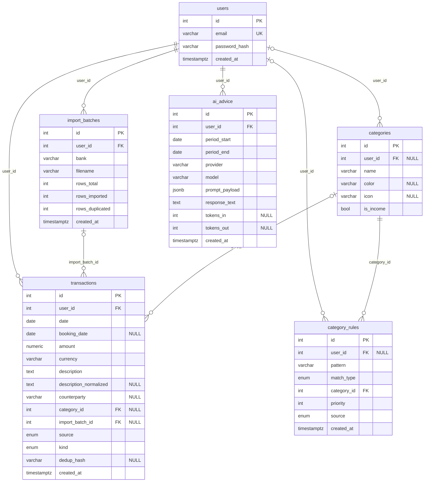

# Diagram ERD bazy danych

Wygenerowany ze schematu aplikacji (`Base.metadata`). Stan: tydzień 2. Tabela `bank_profiles` dojdzie w etapie 4.

**Reguły usuwania:** usunięcie użytkownika kasuje wszystkie jego dane. Usunięcie kategorii lub importu zostawia
transakcje bez powiązania, a reguły znikają razem ze swoją kategorią.

**Unikalność złożona:** `categories (user_id, name)` i `transactions (user_id, dedup_hash)`.

**Wartość `NULL` właściciela** w `categories` i `category_rules` oznacza kategorię lub regułę systemową.
